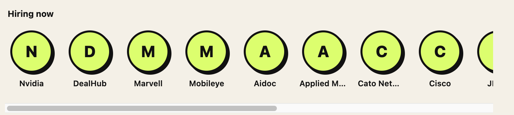
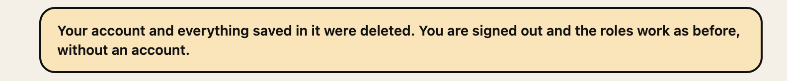
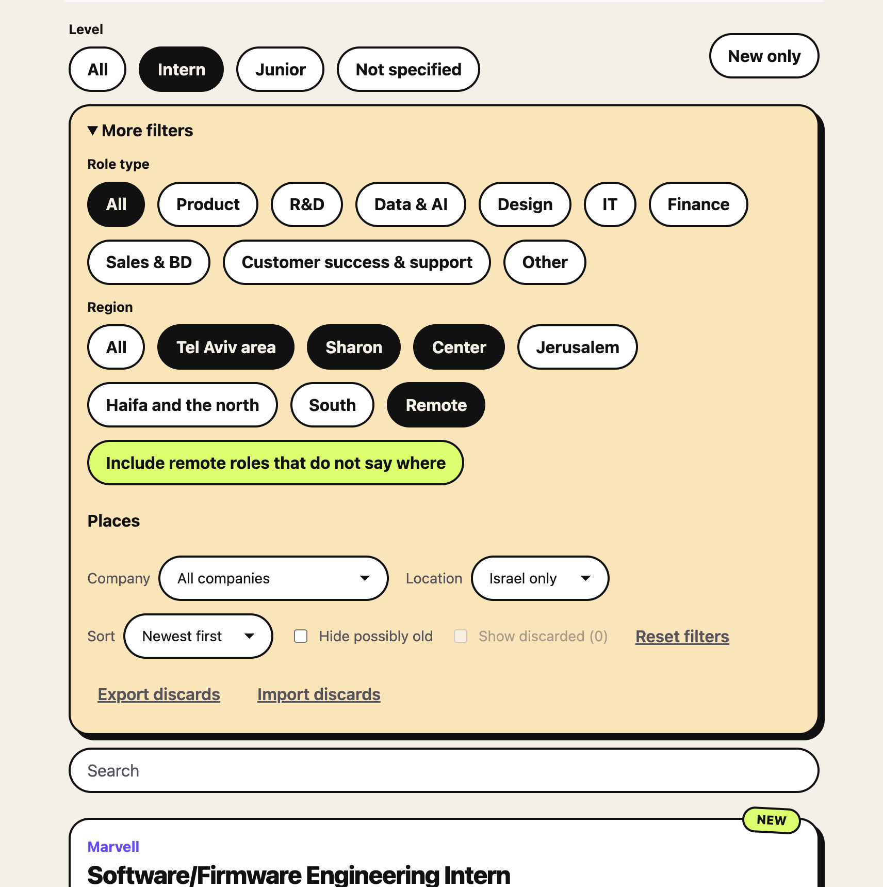
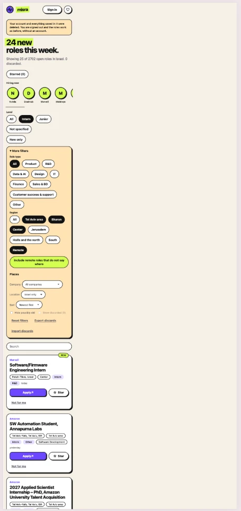

# TODO

Open work, as of 2026-11-14. Each item says what triggers it, how to do it and when it is done. When one is finished,
delete it and update the counts in the others: the 93 and the four segment counts in the research item (a pin removes
one row from one segment), its "(30)" if the company had no careers URL, else its "(63 today)".
An item with a screenshot in `todo-images/` goes with it: delete the image file in the same PR.
Observations about live sites below come from checks made on 2026-11-14 and may have changed.

## Web app fixes

- [ ] **"Hiring now" row scrolls sideways.** Trigger: whenever there are many companies in the row (up to 15 are
  shown), `.stories` scrolls horizontally and the last circle is cut off. A horizontal scroll should almost never
  appear.

  
  - Where: `.stories` in `templates/dashboard.css` (`display: flex` with `overflow-x: auto`); the items are built by
    `renderStories` in `templates/dashboard.js`; the circles are `design-system/components/story.css`.
  - How: let the row wrap (`flex-wrap: wrap`) or use a grid that fits the width, and drop `overflow-x: auto`. Check on
    a phone width and in light and dark. Edit the templates, never `docs/`.
  - Done when: 15 companies show with no horizontal scrollbar at 375px and at desktop width.

- [ ] **The "account deleted" notice has a different border from the other cards.** Trigger: delete an account; the
  message "Your account and everything saved in it were deleted..." (`MESSAGES.deleted` in `templates/auth.js`) shows
  in a `.notice`.

  
  - Where: `.notice` in `design-system/components/field.css` has a hard-coded `border-radius: 16px` and no shadow,
    while `.card` (`design-system/components/card.css`) uses `--radius-card` and `--shadow-md`. The `.import-offer`
    in `templates/dashboard.css` adds `--shadow-md` by hand for the same reason.
  - How: decide whether a notice should look like a card; if so, use `--radius-card` and `--shadow-md` in `.notice`
    (and drop the hand-added shadow), and check the other notices (`.sync-note`, the email page) still look right in
    light and dark.
  - Done when: the notice and a card have the same border, radius and shadow.

- [ ] **Search is hard to find.** Trigger: user reviews say the search is unusable because it is hidden. In the
  screen they sent, the search box sits below the "More filters" panel, under Level, Role type, Region, Places and
  Sort, so on a phone it is far down the page and easy to miss.

  
  - Where: the search field and the `controls` bar in `templates/dashboard.html`; layout in `templates/dashboard.css`;
    field styles in `design-system/components/field.css`.
  - How: redesign it with Claude Designer plus the UI/UX experts, starting with the `design-super-agent`,
    `ui-design-review` and `ux-web-review` skills, and keep the result inside the design system (tokens only, 44px
    targets, light and dark, WCAG AA). Have them propose two or three layouts, for example search first and always
    visible at the top, sticky on scroll, with a clear button, and filters collapsed below it. Pick one, then build
    it from the templates, never `docs/`. Keep the WebMCP search tool in `templates/dashboard.js` working.
  - Done when: a first-time visitor finds the search without scrolling or opening a panel, at 375px and at desktop
    width, and the review of the two or three layouts is recorded in the PR.

- [ ] **Give every coverage gap a link.** Trigger: the coverage gap card lists company names with a reason but no
  link, so a visitor who wants those roles has nowhere to go. Applies to all seven reasons (the keys of
  `build_dashboard.REASONS`).
  - What each reason links to:
    - Blocks automated access (`bot_protection`, and the crawl-failing sites blocked by HTTP 401/403): the blocked
      careers page itself. A person in a browser can open it.
    - No careers page found (`no_careers_url`): the company's own site (`https://<domain>`).
    - Site down, parked or unreachable (`site_unusable`): the company's own site, same as above.
    - No open roles in Israel, or the board is closed (`no_openings`): the careers page or board.
    - Roles are listed, but we cannot read them yet (`needs_reader`): the careers page, where the roles are.
    - No job feed found yet (`no_feed_found`): the careers page.
    - Failing in the latest crawl (`crawl_failing`): the careers page.
  - Where: `build_dashboard.py` builds the gap groups and the sites in each (the `gaps` object in `jobs.json`);
    `templates/dashboard.js` draws them (the `gap-sites` list); styles in `templates/dashboard.css`.
    `data/unresolved_candidates.csv` has only `domain`, so it needs a `careers_url` column or a lookup in
    `data/companies.json` (which has `careers_url` for most); a link for a site that is down or parked must not point
    at a parked page, so use the domain only when the careers address is missing.
  - How: add a `url` to each site in the `gaps` data; render the name as a link that opens in a new tab with
    `rel="noopener noreferrer"`; follow the design system (visible focus, 44px target, light and dark). Only
    `https:` addresses. Update the tests (`tests/`, and the `jobs.jsonld` and `data-*` hooks if they carry the list),
    the CSV columns if you add one (CRLF line endings, update `tests/test_todo_counts.py` if it reads them), and
    `CHANGELOG.md` with a version bump (a Python module changes).
  - Done when: every site on the card is a working link, and a test fails if one has no address.

- [ ] **Show how many companies we cover.** Trigger: nothing on the dashboard says how many companies Misra crawls
  each day, which is the main reason to trust it. As of 2026-11-15 `data/companies.json` has 253 companies, 234 with
  status `ok`; the number must come from the data, not from text typed into the page.
  - Where: the count is already in the build data (`build_dashboard.py`, `docs/jobs.json`); the page is
    `templates/dashboard.html`, drawn by `templates/dashboard.js`.
  - How: do three consults before writing code, and record the answers in the PR.
    1. Claude Designer and a UI/UX expert (`design-super-agent`, `ui-design-review`): where it goes (the page header,
       next to the "Hiring now" row, above the search, or the footer), how loud it is (a quiet line or a stat tile),
       and how it behaves on a phone, in light and dark. It must not push the search or the jobs further down.
    2. The `technical-writer` agent (`.claude/agents/technical-writer.md`): the exact words, short and true. Decide
       what the number counts (companies with a working feed, not every company we tried) and whether to add the
       coverage gap count next to it, so the claim stays honest. No fluff, no superlatives.
    3. Decide whether the same line also belongs in the digest email, the README and `llms.txt`.
  - Build it from the templates, never `docs/`. Use tokens only, with the number as one `data-*` hook so agents can
    read it. A new count means a test that the number matches `data/companies.json`.
  - Done when: a visitor sees the count without scrolling at 375px and at desktop width, the number is computed at
    build time, and a test pins it to the data.

- [ ] **Make the web app work well on a phone.** Trigger: most users open Misra on a phone, and it looks bad there.
  From the iPhone 16 view (393 px wide) in Chrome's device mode:

  
  - the filters (Level, Role type, Region, Places, Sort) fill the first screens, so the jobs start far down the page;
  - the search box comes after all of them (see "Search is hard to find");
  - the "Hiring now" row scrolls sideways (see its item);
  - the controls are small and dense (tiny chips, small checkboxes and links) and may miss the 44 px target;
  - notices and cards use different borders and shadows (see "account deleted" item).
  - Where: layout in `templates/dashboard.css`, markup in `templates/dashboard.html`, components in
    `design-system/components/*.css`. Edit the templates, never `docs/`.
  - How: three consults before code, recorded in the PR.
    1. Claude Designer and the UI/UX experts (`design-super-agent`, `ui-design-review`, `ux-web-review`,
       `accessibility-expert`): design mobile first. Start from the jobs and the search, with the filters in a bottom
       sheet or a "Filters" button that shows the number of active filters, quick chips for the level, and cards that
       show the title, company, place and Apply first. Test at 320, 375, 393 and 430 px, in portrait and landscape,
       in light and dark.
    2. The `technical-writer` agent (`.claude/agents/technical-writer.md`): shorter labels and headings that fit a
       small screen, one word per concept.
    3. Do one pass with real devices or the iOS Simulator and Chrome device mode, and list what breaks.
  - Fold the three related items (search, "Hiring now" scroll, notice border) into this one design so they are not
    fixed one by one in different styles.
  - Keep the design system rules (tokens only, 44 px targets, WCAG AA) and the agent hooks (`data-*` on
    `article.card`, `jobs.jsonld`, the WebMCP tools). Add a test that fails on a horizontal scroll at 320 and 393 px
    (Playwright, as the browser tests do).
  - Done when: the first screen at 393 px shows the search and the first jobs, no page scrolls sideways at 320 px, every
    control is at least 44 px, and the PR shows before and after screenshots.

- [ ] **Run the technical writer agent over all the text in the app.** Trigger: when you are ready for a copy pass;
  nothing blocks it.
  - Where: the agent is `.claude/agents/technical-writer.md`. It reads the docs and every text source, then tightens
    the wording (short, exact, no fluff) and keeps identifiers, `data-*` hooks and `REASONS` keys unchanged.
  - How: ask Claude Code to run the `technical-writer` agent. It edits `templates/` and the sources, rebuilds `docs/`,
    and runs lint and tests. It lists proposed edits to `PRIVACY.md` and the lawyer-approved wording instead of making
    them: review that list. A change to a listed Python module needs a version bump and a changelog entry.
  - Done when: the PR is merged, `npm run lint` and `npm run test:coverage` pass, and you have decided on the legal
    wording it left for you.

## Yearly security review

- [ ] **Do the yearly security review by 2027-11-15, then every year.** Trigger: the date. Where: the internal
  security note kept by the maintainer (it lists the checks: provider logs, who has access, two-factor sign-in, key
  rotation, Dependabot and CodeQL alerts, and re-reading `PRIVACY.md` and `TERMS.md` against the product).
  - Done when: the checks are done and the date and result are written in the note, and this item is moved to the
    next year.

## Review the Node and Python pins

- [ ] Trigger: Node 27 becomes LTS (scheduled 2027-10-20) or Python 3.12 nears its end of life (October 2028), whichever
  comes first. Nothing to do before then.
  - State now (as of 2026-11-14, from the Node release schedule and the Python release page): Node 26 has been LTS since
    2026-10-28 and `.nvmrc` is on its latest release (26.13.1). Python has no LTS; 3.12 is the floor and the version CI
    and the daily job run.
  - Where the pins live, to change together:
    - Node: `.nvmrc`; `engines.node` in `package.json` (`>=26.13.1 <27`, so the cap must be raised too); the same
      `engines` value under `packages[""]` in `package-lock.json` (regenerate it with `npm install`; the other `engines`
      lines in the lock file belong to dependencies and are left alone); `packageManager` in `package.json` (npm 11.20.0
      today: check it still fits the new Node); the Node badge and "Node 26" in `README.md`. The `ci.yml` and
      `release.yml` workflows read `.nvmrc`, so they follow.
    - Python: `python-version` in `ci.yml`, `release.yml` and `daily.yml`; `requires-python`, ruff `target-version`
      and mypy `python_version` in `pyproject.toml`; "Python 3.12+" in `README.md`.
    - Playwright is pinned twice, `playwright==1.65.0` in `pyproject.toml` and in the `pip install` line of `daily.yml`,
      and the two must change together: Dependabot can bump `pyproject.toml` but not the workflow line, and `daily.yml`
      also installs `requests` unpinned. Check that the pinned version supports a new Python before moving it.
  - Steps:
    1. Check the dates at the Node release schedule and the Python release page; take the newest LTS (Node) or the
       newest release that Playwright and the dev tools support (Python).
    2. Change the pins above in one PR. It touches `package.json` or `pyproject.toml`, so it needs a version bump and a
       `CHANGELOG.md` entry (see `AGENTS.md`); the version moves in `package.json`, `pyproject.toml` and the root entry
       of `package-lock.json`.
    3. Run `npm run lint`, `npm run typecheck` and `npm run test:coverage` on the new versions, with Chromium installed
       so the browser tests run (a machine on an older Node cannot `npm ci`: use the new Node).
    4. After the merge, run the daily workflow once by hand (Actions, "daily-job-digest", Run workflow) and check it is
       green.
  - Done when: the pins name the new versions and that manual run passed. Put the next review date here.

## Research the remaining unresolved companies

- [ ] `data/unresolved_candidates.csv` lists 93 researched companies with no usable job feed (as of 2026-11-14: 24
  multinational, 42 deeptech, 13 cyber_infra, 14 biz_software). Each needs
  its own research; there is no batch fix left. Every observation about a live site below is from the checks of
  2026-11-14, a crawl of the 105 rows that had a careers URL that day (63 today) and a scan of their rendered pages. The
  remaining work falls into these groups:
  - **No careers URL (30).** Status `not_found` in `data/new/*_companies.json`: OX Security, Upsolver, Ceva, Speedata,
    Teramount, X-Globe, Q Factor, Gilat, Siklu, Silicom, Sight Diagnostics, Brainsway, EarlySign, Diagnostic Robotics,
    Tevel Aerobotics, CytoReason, Converge Bio, SolarEdge, Watergen, Stratasys, AIR, Intel, SAP, eBay,
    Autodesk, Akamai, Ford, Ericsson, Uber, Keysight. Find the real
    careers page first, then continue with the groups below. The large multinationals will need a location-filtered
    address or their ATS (see the last group).
  - **A job board was found but there is no adapter.** Playstudios and Booking.com. Playstudios was listed as a Jobvite
    board, but on 2026-11-14 `jobs.jobvite.com/playstudios-inc` is an invalid board and the careers page links to
    Dayforce (`jobs.dayforcehcm.com/en-US/playstudios/CANDIDATEPORTAL`). `browser_crawl.crawl_many` reads its 12 jobs with
    real titles and distinct links but an empty location for every one, so none could be recognised as Israel (the page
    shows 5 in Tel Aviv-Yafo), so it is not a browser pin. The portal has a JSON search (`POST
    /api/geo/playstudios/jobposting/search`, locations as `formattedAddress`); a Dayforce adapter would read it, but no
    other company in the lists is on Dayforce, so write one only when a second appears. Booking.com (iCIMS) is skipped: its iCIMS board answered
    403 to a plain request on 2026-11-14 (bot protection, not to be bypassed) and `careers.booking.com` is a custom site
    with no job feed; revisit it with the large multinationals. A new adapter is its own PR: a function in `adapters.py`,
    an entry in `ADAPTERS`, tests with the fakes in `tests/test_adapters.py`, a version bump and a changelog entry.
  - **A board was found but its address is wrong or dead.**
    - Pliops: on 2026-11-14 the Comeet page for `pliops/05.004` said "This Spark Hire Recruit account has been
      deactivated", and it still does, but `pliops.com/careers` still links to that page, so the company has published no
      new board. A Workable account `pliops` exists (`adapters.workable("pliops")` answers with no job) but nothing links
      to it, so it is not pinned: pin it, or the board the careers page ends up linking to, once it lists a job.
    - Western Digital: the SmartRecruiters board (`WesternDigital`, 325 jobs) has no Israel job today, so there is
      nothing to show. It can be pinned with `israel_only` now that the matcher and the new-company rule are fixed, but it
      would fetch 325 jobs a day to store none.
    - Cloudflare: the Greenhouse board's locations are "Hybrid" or "Distributed", never a city, so an Israel job could
      not be recognised. The adapter would need to read the offices (`?content=true`) first.
  - **The page returned links, not jobs.** Checked on 2026-11-14: Ex Libris links to `careers.clarivate.com`, a
    worldwide Phenom board of its parent Clarivate (not Ex Libris only); Ormat's list is a ViziRecruiter board
    (`vizi.vizirecruiter.com/OrmatTechnologiesInc-4638`, one company so no adapter); Optibus has no feed in its page or
    network requests; REE Automotive is in the next group.
  - **Large multinational boards that show a worldwide first page.** Google, Intuit, Apple, IBM
    and others returned jobs, but almost none in Israel (Apple's page had one), because the page is a worldwide search.
    They need a career address filtered to Israel (as `citi.eightfold.ai/careers?location=Israel` is) with `israel_only`,
    or their ATS. Check that the filter works before pinning.
    Findings on the 24 multinationals left after the pins of 2026-11-14 (so the next person does not repeat them):
    - Workday guesses that still do not answer (checked again on 2026-11-14 after the adapter fix): Intel
      (`intel/wd1/External`) and Autodesk (`autodesk/wd1/Ext`, `autodesk/wd1/uni`) are sent to Workday's maintenance
      page, which is also what a tenant that does not exist on that data centre gets, and Akamai
      (`akamai/wd1/akamaicareers`) answers 500. The tenant, data centre or site name is still unknown: find it from the
      company's own careers page, not by guessing.
    - Bot protection (403 to a plain request, 2026-11-14; not to be bypassed): Intel (`jobs.intel.com`), Autodesk,
      Akamai, General Motors (`search-careers.gm.com`), Ford, SAP, Uber, Booking.com.
    - Other platforms with no adapter yet: AMD and Keysight (iCIMS: `careers-amd.icims.com`,
      `careers-keysight.icims.com`), Synopsys (Avature: `synopsys.avature.net`), Intuit (Radancy: the search takes a
      location only with coordinates and shows "Multiple Locations" for many jobs), Google (the results page embeds
      its data; the crawler read only navigation links on `?location=Israel`), Apple (`jobs.apple.com/en-il/search`
      is a script app; `/api/role/search` answers a redirect), IBM and Meta (no feed found).
    - Ericsson: `jobs.ericsson.com/careers?location=Israel` is an Eightfold board that shows "0 jobs" in Israel today,
      and the crawler reads its "Join Talent Network" link as a job, so it is not pinned; pin it once it lists one.
    - eBay (`careers.ebayinc.com`), Walmart Global Tech (`careers.walmart.com`, a timeout), Siemens
      (`jobs.siemens.com`, no DNS answer), Align Technology (`jobs.aligntech.com`) and Rapid7
      (`careers.rapid7.com/jobs/search`): no feed found in the page HTML; not investigated further.
    - Done on 2026-11-14: new adapters `oraclehcm` (Oracle, JPMorgan Chase, Dell, American Express, Nokia), `amazon`
      and `phenom` (Cisco, GE HealthCare, Mastercard); Workday pins (Salesforce, Cadence, Edwards, Adobe, Zoom,
      Marvell, Medtronic, KLA, Kyndryl, Workday, then Broadcom and Philips once the adapter read a country value with
      its own id and the places of a location facet); HP on Eightfold. American Express and Nokia list no job in
      Israel today, and Adobe and Zoom none either.
  - **Pages that loaded and showed no job links.** 72 of the 105 pages crawled on 2026-11-14 returned no job, five of
    them with an empty title: the list is probably drawn by JavaScript from a JSON feed. Open the page, watch its network
    requests for the feed, then decide between an adapter and a browser pin.
    Findings of 2026-11-14 (feed-finding pass): most of these pages were not JavaScript apps but WordPress sites with the
    Comeet plugin, whose job links look like `/careers/co/<place>/<XX.XXX>/<title>/all`, which the crawler's link pattern
    does not match. The page source holds `"comeet_uid":"<uid>"` (and a token) when the plugin is configured with the
    company's account; the `comeet` adapter then reads the board with slug `<name>/<uid>`. Try the careers-api first, as
    `https://www.comeet.co/careers-api/2.0/company/<uid>/positions?token=<token>&details=true`: its jobs carry the board
    name in `url_comeet_hosted_page` (any name works for a valid uid; a wrong uid gives no data). Done: Retym
    (`retym/C6.003`), Qedma (`qedma/7A.006`), Qodo (`qodo/B8.00B`), Trigo (`trigo/A6.005`), Cyolo (`cyolo/F5.005`; its page
    shows a `company-uid` in the job page source, not the careers page), Allot (`allot/C4.009`, 24 jobs, one in Israel;
    the uid is also in a vacancy page), and three boards with no job today, pinned with `israel_only` so the first Israel job
    reaches the digest: Foretellix (`Foretellix/84.007`), XM Cyber (`xmcyber/15.005`) and Dataloop (`dataloop/B5.00A`); Sunbit (`sunbit/37.001`, 40 jobs, 8 in Israel; the uid is in the
    source of a `?job=` page) and Firefly (`firefly/39.000`, `israel_only`: the board holds one "Future Opportunities" entry
    with no place), and DarioHealth (`Dario.Health/34.006`, 2 jobs, both in India today).
    Not done, and why (all checked on 2026-11-14, do not repeat):
    - Comeet plugin pages whose account answers 400 ("Account uid or token are not valid") and whose hosted board has no
      data, but whose WordPress page still lists jobs drawn server-side: REE Automotive (uid D3.00B, 2 jobs, one in
      Glil Yam), Gauzy (C5.003, 9 jobs, none in Israel, the Tel Aviv filter is empty) and Apester (58.002). Guesty (24
      positions, several in Israel), Kornit (11 positions, 6 in Israel) and SQream (1 position; its uid 45.00B is a
      board named Scailium with no hosted page) show the same plugin but no uid in the page. Reading them means parsing
      the plugin's links `/co/<place>/<XX.XXX>/<title>/all` out of the page HTML, whose card markup differs by theme; with
      REE, Gauzy, Guesty, SQream and Kornit on it, one adapter could be justified (titles from the markup, a failed
      parse returns None).
    - Comeet account valid but not the company's own board: Magic Software (19.00F is Matrix IFS, 23 jobs, none in
      Israel). NeuReality (89.002) answers no job and says there are no open positions: pin it once it lists one (the
      hosted page is not served, so the `comeet` adapter returns None for it).
    - No openings at all, no feed to pin: Mitiga ("We don't have any openings right now"), Applitools ("No openings
      available"), H2Pro and Madgicx (no open positions; Madgicx takes CVs through a ClickUp form).
    - Own-site pages the crawler's link pattern does not match, no ATS behind them: Pillar Security
      (`/open-position/<slug>`, 1 Tel Aviv job), Walnut (`/jobs/<slug>`), env0 (`/careers/<slug>`), Deep Instinct (PDF job
      descriptions, none in Israel), Firefly's own `/positions/` pages (Firefly itself is pinned above), Syte (job list
      by script, no job link), Tyto Care and StoreDot (list or CV form with no job link), Swimm (an email address).
    - Dead or unusable: Jelly Button Games, Kahun, Nucleai and Quantum Art (domain parked at GoDaddy), Satixfy (now an
      MDA Space page), Line 5 (needs a login), lakeFS and Quantum Art (403 or "Access Denied": bot protection), Radware
      and Camtek (an empty page), Elbit Systems (timeout on the news page; its careers site `elbitsystemscareer.com` is a
      Hebrew custom site with no feed seen), ReWalk (its list on `golifeward.com/company/careers/` is US jobs, no Israel
      job), Lumigo, Aniview, AnyClip, Pay-Me, Evogene, Aleph Farms, Remilk, Redefine Meat, Landa, Nano Dimension, Tabit,
      Cognata: no ATS link, feed or job link in the HTML or the network
      requests; not investigated further.
  - **Bot protection.** Some pages answered 403, "Access Denied" or a browser check. Leave them and record it. Do not try
    to get around bot protection: a few pinned companies (Check Point, Papaya Global, Unity) are already blocked from the CI
    runner this way and show up as gaps in the digest.
  - How to research a company:
    1. Find the real careers page, then look for the job board it uses: an embedded or linked Greenhouse, Lever, Ashby,
       Workable, SmartRecruiters, Comeet or Workday board (`discover.ATS_LINK` has the patterns, and the page's HTML,
       links and iframes all need a look, since scripts hide them) or a JSON feed in its network requests.
       A Workable job link on a page is `apply.workable.com/j/<shortcode>`: it names no account (open it: it redirects
       to `apply.workable.com/<account>/j/<shortcode>`). `ATS_LINK` skips these links since 0.10.1.
    2. With an existing adapter, probe it from a shell (`adapters.ADAPTERS["greenhouse"]("slug")` and so on). Without
       one, the browser crawler is the fallback: `browser_crawl.crawl_many([url])` (set `PW_CHROMIUM` to a Chromium
       build, or run `playwright install chromium`) shows what it reads.
    3. Read the result before pinning. It needs real titles, distinct links and a location per job that the Israel matcher
       (`discover.ISRAEL`) can recognise, for the jobs that will appear and not only the ones there today. A list of
       navigation links, a worldwide first page or a partial list is not a feed.
    4. Pin with four edits (`israel_only` for a large multinational), one company or one source per PR so a bad pin is
       easy to drop. Edit the files by hand and append at the end: do not rerun `discover.py`, which re-probes every
       company and rewrites `data/companies.json`.
       - `data/overrides.json`: `"Visa": {"ats": "workday", "slug": "visa/wd5/Visa", "israel_only": true}`
       - `data/companies.json`: `{"name", "domain", "careers_url": "", "ats": "workday", "slug", "source": "override",
         "status": "ok", "n_jobs", "n_israel", "israel_only": true}`, with `n_jobs` and `n_israel` from the probe (an
         `israel_only` adapter returns Israel jobs only, so they are equal; the domain is in
         `data/unresolved_candidates.csv`)
       - `data/seed_companies.csv`: one `Name,domain` row
       - remove the row from `data/unresolved_candidates.csv`
       - both CSV files use CRLF line endings: keep them, and update the counts named at the top.
       A board with no Israel job today is fine to pin: the `israel_only` rule reports the first Israel job it ever
       lists. Code changes (an adapter, a parser fix) need a version bump and a changelog entry; data-only PRs do not.
       Probe a Workday slug with `.venv/bin/python -c "import adapters; print(adapters.workday('visa/wd5/Visa'))"`:
       `None` is a host that did not answer with a job search (Workday tenants go to a maintenance page for hours at a
       time, and answer again later: probe on more than one day before giving up), `[]` is a board with no Israel job.
    5. If a company cannot be done, say why. Set the `reason` (one of the keys of `build_dashboard.REASONS`) and a short `note` of
       the row in `data/unresolved_candidates.csv`: the coverage gap card reads them, and `tests/test_todo_counts.py` fails
       when the counts quoted here and the rows disagree.
  - Tools: `browser_crawl.crawl_many` over every row with a careers URL, and a scan of the rendered pages for ATS links,
    were the two passes behind this list; both were throwaway scripts and are not in the repo. Adding them as a dev tool
    next to `survey.py` and `survey2.py` would make a re-run easy (a new module must be registered as `AGENTS.md`
    describes).
  - Done when: `data/unresolved_candidates.csv` is empty, or every remaining row has a `reason` that says why it cannot be done.
